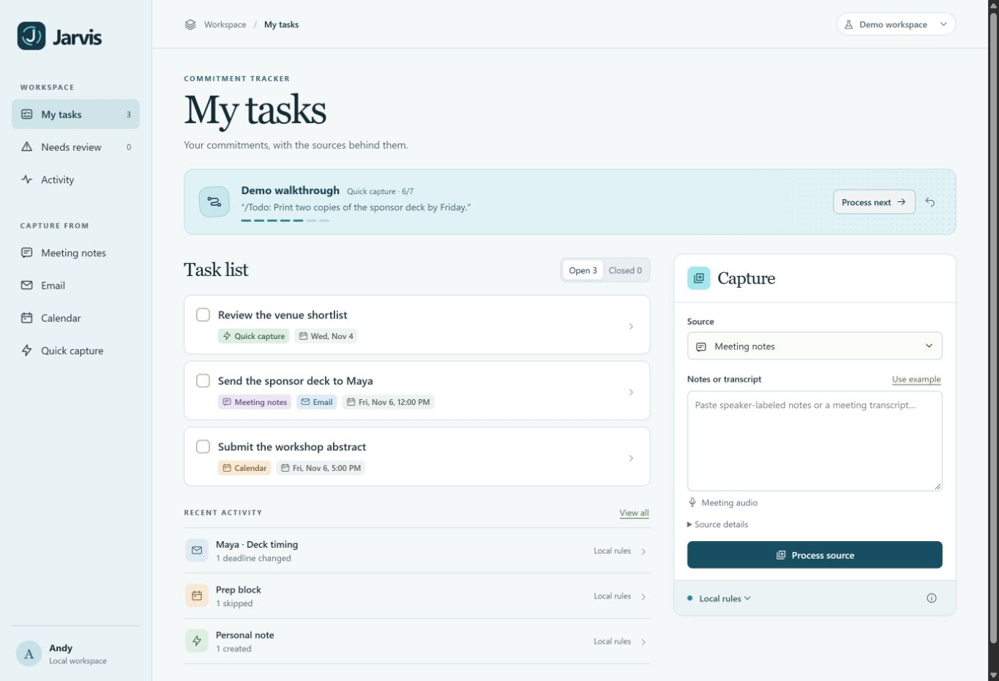

# Jarvis

If someone moves a deadline in an email, updating your to-do list becomes one more thing to remember. Miss that step and the list faithfully reminds you of the wrong date.

Jarvis is a personal productivity assistant. Its first job is keeping track of what you owe. Give it meeting notes, an email, or a calendar entry and it updates your list. Click a task to see the sentence behind the change. If “Monday works instead” could refer to several tasks, Jarvis asks you to choose.

## Try it in two minutes

With **Node.js 22.13 or newer**, run the following from the project folder. The core demo needs no API key or package installation.

~~~sh
node server.mjs
~~~

Open [localhost:4317](http://127.0.0.1:4317/) in your browser. On Windows you can instead double-click **Open Jarvis.cmd** to start the server and open your default browser. Choose **Demo workspace** and **Local rules** for a free, repeatable walkthrough. Click **Process next** four times and watch what happens to one commitment:

1. Wednesday’s calendar block reserves time to work on the sponsor deck. The Thursday deadline still stands.
2. Maya emails that the slides are due Friday at noon. The existing task gets a new deadline and a second source.
3. You type **/Todo: Print two copies of the sponsor deck by Friday.** Printing becomes a separate task.
4. Maya sends the deck herself. Jarvis closes the sending task and keeps the print job open.

Switch to **Personal workspace** for your own tasks. Type in the **New task…** row and press Enter; the calendar icon adds an optional deadline. Check the circle beside a task to complete it. Manual tasks never call Claude. Desktop captures always go to [Personal tasks](http://127.0.0.1:4317/?space=personal) and appear automatically when the tab is visible.

For a second demo, leave the engine on **Local rules**. Select **Meeting notes → Use example → Process source**, then do the same with **Email**. The Repair Café meeting gives you three jobs and gives Priya one. Only your three land on the list. Maya’s follow-up moves the entrance map to Wednesday at 3 pm, closes the printing task she finished, and adds two requests. Open the entrance-map task to see both sources.

## What you can capture

| Source | Available today |
| --- | --- |
| Meeting | Paste notes or a transcript. With local Whisper installed, transcribe a file or record up to five minutes from a microphone or shared browser tab. Review the transcript, then process it for tasks and minutes. |
| Email | Paste a message. Set its original date and sender when interpreting a relative deadline or a first-person commitment. |
| Calendar | Paste an event or select one entry from an imported calendar file. Try the [sample calendar](examples/student-calendar.ics). |
| Quick task | With the optional Windows helper running, type **/Todo:** or **/todo** followed by Space in a text field, or press **Ctrl+Alt+J** without a text field. Type the task in the box and press Enter to save to your Personal workspace. |

You choose which sources enter the prototype. Jarvis handles the bookkeeping after capture. Automatic inbox, calendar and course-site sync, scheduled reminders, and background meeting capture are future work.

## Where AI fits

Local rules handle explicit assignments and common deadline changes. Optional Claude extraction handles freer language using the new source and up to 30 short task records. Whisper runs speech recognition on your computer. The server checks source quotes and task IDs before saving changes to SQLite. You can inspect, edit, or undo a change.

[Setup for Claude, speech, and desktop capture](docs/setup.md) · Run the regression suite with **node --test**.
